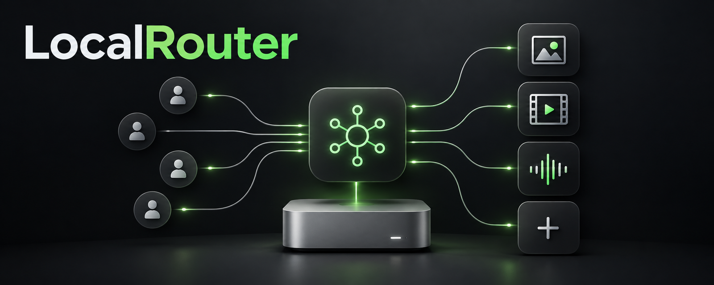

<p align="center"></p>
<p align="center"><a href="https://x.com/jayleaton"></a> <a href="https://buymeacoffee.com/jayleaton"></a></p>

> [!WARNING]
> **Early preview.** LocalRouter is new and under active development: expect bugs and breaking changes. Please [open an issue](https://github.com/jayleaton/localrouter/issues) if something doesn't work.

**LocalRouter turns one NVIDIA DGX Spark into a full-duplex "Jarvis" box.** You talk to it and it talks back. You can
interrupt it mid-sentence, and it can make a picture or a video while you talk. Everything runs on the box:

- **Chat:** Qwen3.8 27B on TensorFold, with the DFlash2 drafter.
- **Voice:** Fish Audio Drama 3, streamed as it speaks, with six fixed voices.
- **Hearing:** Whisper large-v3-turbo with the Silero VAD.
- **Images:** Qwen-Image 2.1 Turbo.
- **Video with audio:** MiniMax H3.

One small Zig daemon owns the machine. It keeps the voice loop and chat warm, loads the other models when asked,
makes room for them, and hands every tool to your agents over MCP and an OpenAI-compatible API.

## Quick start

Tell your coding agent (Claude Code, Codex, T3, ...):

> *Read INSTALL.md and set up LocalRouter Jarvis on this box.*

[INSTALL.md](INSTALL.md) is written for agents. It is a deterministic sequence of commands, with what to check at each
step and what to ask you: which licences you accept, and whether the GPU may be used. To run it yourself:

```bash
git clone https://github.com/jayleaton/localrouter && cd localrouter
tools/install/bootstrap.sh --profile jarvis-gb10 --dry-run   # the plan: steps, downloads, disk, memory, licences
tools/install/bootstrap.sh --profile jarvis-gb10 --accept    # after reading the licences the plan lists
```

**What it does.** It installs every model of [deploy/profiles/jarvis-gb10.json](deploy/profiles/jarvis-gb10.json), checks
every download against its pin and qualifies chat and Drama 3 on the GPU. It leaves one systemd user service on
`127.0.0.1:8190`, which starts at boot and is reachable on your tailnet through `tailscale serve`. It is resumable: after
a failure, do what it says and run it again. Models already on the box are reused, not downloaded again.
`tools/install/doctor.sh --profile jarvis-gb10` lists anything missing, with its fix.

**A fresh install on DGX-01** (measured 2026-10-22):

| Part | Measured |
| --- | --- |
| Downloads and builds | 31.5 min, 175.7 GB downloaded |
| Chat qualification on the GPU | 113 s |
| Drama 3 qualification on the GPU | 20.5 min |
| Image and video pack builds | not yet timed end to end |

## What you get

| Where | What |
| --- | --- |
| `/voice` | The web app. A full-duplex voice conversation: barge-in, spoken picture requests, and a voice picker with previews |
| `/v1` | OpenAI-compatible API: chat completions (whole or streamed, with tools), audio speech and transcriptions, images, videos, and the Realtime API at `/v1/realtime` |
| `/mcp` | Every tool over MCP: `chat`, `synthesize_speech`, `transcribe_audio`, `generate_image`, `generate_video`, `list_models`, jobs. See [docs/AGENTS.md](docs/AGENTS.md#mcp-the-easy-way) |

```bash
claude mcp add --transport http localrouter http://127.0.0.1:8190/mcp
```

## Measured on a DGX Spark

DGX-01, NVIDIA GB10, 2026-10-22. Only figures we measured are listed.

| What | Measured |
| --- | --- |
| Voice turn: end of speech to first audio | about 0.9 s median (916 to 959 ms across today's smoke runs); 0.72 to 0.95 s for the first turn after an image or a video |
| Drama 3: first audio | 0.14 s p50, 0.18 s p95. Real-time factor 0.68. From its GPU qualification |
| Chat: first content | 0.15 s for a short prompt, streamed |
| "Generate a picture of a dog", spoken | picture done 8.1 to 10.2 s after the end of speech; spoken confirmation 8.8 to 11.4 s |
| Image: Qwen-Image 2.1 Turbo, 1024x1024 | 6.3 s warm |
| Video: MiniMax H3, 768x448 with audio | a 1 s clip in about 24 s; a 5 s clip in 54 s warm |
| Memory with chat, Drama 3, Whisper and the image model warm | 24 + 42 + 3.6 + 35.2 GiB resident; 13.7 GiB still available after a start, 11 to 12 GiB in use, of 121.7 GiB |

A video job unloads only the image model while it runs, and the image model comes back after it. Chat, Drama 3 and
Whisper are never unloaded for an image or a video.

## Hardware

| Need | jarvis-gb10 (the tested profile) |
| --- | --- |
| Box | NVIDIA DGX Spark (GB10, `aarch64`): 128 GB unified memory, at least 110 GiB visible to the OS |
| Software | DGX OS / Ubuntu 24.04, NVIDIA driver 580 or newer, CUDA 13 (`nvcc`), Docker with the NVIDIA runtime (for the image and video packs), systemd user services |
| Disk | about 250 GiB free for a fresh install (216 GiB plus a 30 GiB margin). `--dry-run` prints the exact figure |
| Network | HTTPS to huggingface.co, github.com, ziglang.org, pypi.org, download.pytorch.org and nvcr.io during the install |

No other profile is tested yet. The chat and Drama 3 engines here are GB10 builds, and their qualification refuses
other GPUs.

## How it works

- **One door for every agent.** Add one MCP server, or point any OpenAI client at `/v1`.
- **Memory is managed for you.** Each model says what it needs before it loads. If it does not fit, idle models of
  lower priority give way. Kept-warm models (the voice set and chat) come back by themselves, and only with room to
  spare.
- **Correct.** The image and video engines are LocalRouter's own, written in Zig with their own GPU kernels. They are
  verified operation by operation against a Python reference of each model, then from prompt to pixels and audio
  samples. Chat and Drama 3 are qualified on the box's own GPU before the service serves them.
- **Small.** One Zig binary. Every loaded model is its own process, so unloading returns all of its memory and a crash
  costs one job.

## Image and video only (Docker)

`bash tools/spark/install.sh` installs just the image and video models as a Docker service. The script's header
documents it: `MODELS`, `PRECISIONS` (FP8 by default, NVFP4 optional), `IMAGE_MODELS`, and binding with
`LOCALROUTER_BIND=localhost|tailscale|all`. Prebuilt Qwen-Image 2.1 packs are optional, from
[Hugging Face](https://huggingface.co/jayleaton/localrouter-qwen-image-2.1), for non-commercial research or evaluation
only under the Qwen Research License.

## Connect an agent

Any MCP client: `{"mcpServers": {"localrouter": {"type": "http", "url": "http://<host>:8190/mcp"}}}`. For clients that
only speak stdio: `localrouter mcp-stdio --url http://<host>:8190`. The HTTP API, field by field, is in
[docs/AGENTS.md](docs/AGENTS.md), and an agent skill is in [skill/localrouter](skill/localrouter/SKILL.md).

## Configuration

`localrouter serve --config tools.json` (the installer writes one):

```json
{
  "reserve_bytes": 8589934592,
  "defaults": {"text_to_image": "qwen-image-2.1-turbo"},
  "tools": [
    {"id": "qwen-image-2.1-turbo", "kind": "image", "engine": "qwen_image_turbo", "weights": "/models/qwen-image-2.1",
     "priority": 10, "keep_loaded": true, "options": {"precision": "fp8s"}},
    {"id": "qwen-image-2.1", "kind": "image", "engine": "qwen_image", "weights": "/models/qwen-image-2.1",
     "priority": 5, "options": {"precision": "fp8s"}},
    {"id": "qwen-image-2.1-nvfp4", "kind": "image", "engine": "qwen_image", "weights": "/models/qwen-image-2.1",
     "priority": 10, "options": {"precision": "nvfp4"}},
    {"id": "minimax-h3", "kind": "video", "engine": "minimax_h3", "weights": "/models/minimax-h3",
     "idle_ttl_s": 30, "options": {"max_width": 768, "max_height": 448, "max_seconds": 5}}
  ]
}
```

| Key | Default | Meaning |
| --- | --- | --- |
| `host`, `port` | `127.0.0.1`, `8190` | where the API listens. `host` is an IP, `localhost`, `all` (`0.0.0.0`) or `tailscale` (this machine's tailnet IPv4); `--host` takes the same |
| `data_dir` | `/data` | job inputs and outputs (`jobs/`) and worker logs (`logs/<tool>.log`) |
| `reserve_bytes` | 8 GiB | memory always left free for the OS and other services |
| `budget_bytes` | 0 (none) | a cap on what loaded models and running jobs may use |
| `keep_outputs_s` | 86400 | how long outputs stay |
| `defaults` | none | the model a request that names none gets, per capability: `{"text_to_image": "qwen-image-2.1-turbo"}`. Unset: the first model (in config order) that can do it. Each must name a configured model with that capability, or `serve` refuses to start. `localrouter models` and `list_models` show the result |
| `gpu_lock` | none | the host's GPU lock file, the one GPU jobs outside LocalRouter take exclusively. LocalRouter holds it once, shared and without waiting, while any of its models is loaded, and releases it when none is; while someone else holds it nothing loads (503). LocalRouter's own models never take it: they are admitted by memory alone, so chat, speech and transcription stay loaded side by side |
| `allow_private_urls` | false | let input image URLs (edits, image to video) name loopback, private and link-local hosts; by default they are refused, redirects are never followed, and only the daemon's own output URLs are fetched from the machine itself |
| `tools[].engine` / `cmd` | | a compiled-in engine, or any program speaking the [worker protocol](docs/ARCHITECTURE.md#any-program-the-cmd-adapter) |
| `tools[].priority` | 0 (chat: 100) | higher is unloaded later when memory is needed |
| `tools[].keep_loaded` | false (chat: true) | load at start, never unload for idleness, reload as soon as the scheduler is idle (unloading idle tools of lower priority) |
| `tools[].qualification` | none | a file the model's qualify script writes on this machine. Until it exists and says `"qualified": true` the model is listed (`"qualified": false` in `/v1/models`) and refused with a 503 saying it is not GPU-qualified on this host |
| `tools[].idle_ttl_s` | 120 | unload after this long unused (0: right after each job) |
| `tools[].capabilities` | from the engine | `text_to_image`, `image_edit`, `text_to_video`, `image_to_video`, `text_to_speech`, `speech_to_text`, `chat_completion` |
| `tools[].engine` | | `qwen_image` (Qwen-Image 2.1, 25 steps), `qwen_image_turbo` (Qwen-Image 2.1 Turbo, its checkpoint's 8 steps; other step counts are refused), `minimax_h3`, `openai_server` (a model's own OpenAI-compatible server run as the worker: chat), `testpattern` |
| `tools[].options` | | engine settings (precision: `fp8s`, the default, or `nvfp4`; `max_side`; default steps; the Qwen engines' `dit`: the DiT pack directory, default `<precision>` or `turbo-<precision>`) |

There is no authentication: it listens on localhost unless you choose otherwise; use a private network or a tailnet
(the Jarvis install puts `tailscale serve` HTTPS in front of it; `--host tailscale` binds the tailnet address) and never
`all` on an untrusted network.

## Build and test

Zig 0.17.0; ffmpeg for video output. The GPU engines need nvcc and an NVIDIA GPU (sm_120 / sm_121); without `-Dnvcc` the
binary builds without embedded CUDA kernels, and the GPU-free test engine runs the tests. The model engines
remain registered but cannot generate without their kernels.

```bash
zig build                                    # zig-out/bin/localrouter
zig build test                               # unit + integration tests (a real daemon and real workers)
zig build integration-exe && zig-out/bin/integration-test   # the integration tests one at a time, each named as it runs
zig build -Dnvcc=/usr/local/cuda/bin/nvcc -Dsm=121,120   # with the GPU engines
localrouter check selftest                   # a private daemon, one image and one video, no GPU
```

## How it was built

The engines are ports, not wrappers. Each model was first reproduced in Python on the project's own kernels (the
"twin", in `tools/twin`), measured against the reference implementation, then rewritten in Zig and gated against the
twin: every operation alone and chained, then the whole generation, on the target GPU. The measured results and the
milestones are in [docs/dev](docs/dev/).

## Credits

LocalRouter stands on the work of these projects and teams:

- [**TensorFold**](https://github.com/ashhart/TensorFold) by **Ash Hart**. Its CUDA runtime, NVFP4 kernels and Python
  model implementations were the baselines our image and video engines were ported from and verified against. Its
  native server runs the chat model, and Drama 3 runs on it. Thank you, Ash; we expect to contribute parts of the Zig
  work back upstream.
- **Qwen** (Alibaba): Qwen3.8 27B for chat, and Qwen-Image 2.1 and 2.1 Turbo for images.
- **z-lab**: the [DFlash2](https://huggingface.co/z-lab/Qwen3.8-27B-DFlash2) speculative drafter for Qwen3.8 27B.
- **Fish Audio**: [Drama 3](https://huggingface.co/fishaudio/drama-3), the voice. Built with Fish Audio.
- [**drama-tensorfold**](https://github.com/plotarmordev/drama-tensorfold) by **plotarmordev** (Apache-2.0), which ports
  Drama 3 to TensorFold.
- **OpenAI**: [Whisper](https://github.com/openai/whisper) large-v3-turbo, for speech to text.
- [**Silero VAD**](https://github.com/snakers4/silero-vad): voice activity detection.
- **MiniMax**: MiniMax H3, video with audio.
- **NVIDIA**: the DGX Spark (GB10) and the NGC PyTorch container the packs are built in. The INT8 attention kernels
  are SageAttention's, as shipped in NVIDIA's comfy-kitchen.

The weights are downloaded from their publishers under their own licences. Check these terms before installing or
using a model:

- **Qwen-Image 2.1** is restricted to non-commercial research or evaluation under its
  [Research License](https://huggingface.co/Qwen/Qwen-Image-2.1/blob/main/LICENSE).
- **MiniMax H3**'s [Community License](https://huggingface.co/MiniMaxAI/MiniMax-H3/blob/main/LICENSE) excludes the US,
  EU, UK and South Korea, and imposes downstream use conditions.
- **Fish Audio Drama 3**'s weights are under the
  [Fish Audio Community License v1.0](https://huggingface.co/fishaudio/drama-3/blob/e0a9218aa48888270f06ef1ed9ea67622c0e17d2/LICENSE).
  It allows commercial use only under USD 500,000 annual revenue, and no Hosted Service (letting third parties
  generate speech through an API) without a separate licence from Fish Audio. So keep LocalRouter on loopback or your
  tailnet for it ([details](docs/dev/DRAMA3.md#licences)).

The Apache-2.0 licence below covers the software. See [NOTICE](NOTICE).

## License

Apache License 2.0. See [LICENSE](LICENSE) and [NOTICE](NOTICE).
